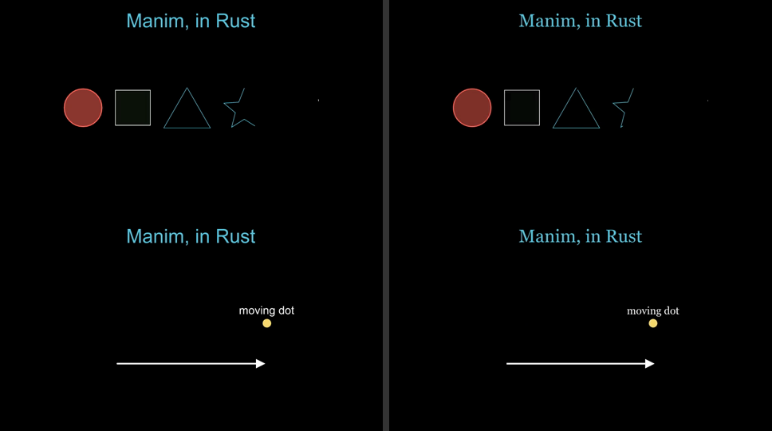
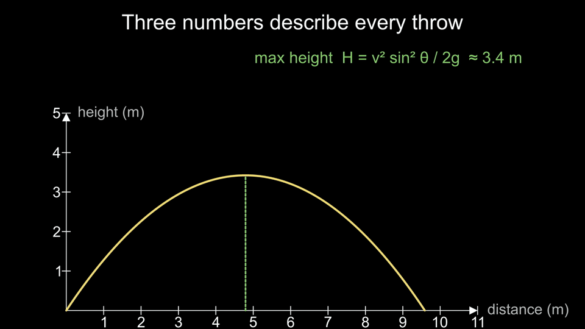

# manim-rust

**A from-scratch Rust rewrite of [Manim Community](https://github.com/ManimCommunity/manim)**, the
mathematical animation engine. It keeps Manim's ideas, names and look, but swaps
Python + Cairo + Pango for Rust, a parallel CPU rasterizer and an optional GPU renderer.
It renders the same scenes **5–13× faster at 480p** and **3–15× faster at 1080p**.

<p align="center">
  
</p>

> **Status:** an independent rewrite, not affiliated with the Manim Community project.
> It covers Manim's 2D core (shapes, text, equations, images, SVG, graphs, ~30 animations,
> updaters, value trackers, sound). It is **not** a drop-in replacement: scenes are written
> in **TypeScript/JavaScript** (run by an embedded engine, no compiler needed) or Rust, and
> 3D is not implemented yet. See [what's missing](#whats-missing).

---

## Python Manim vs manim-rust at a glance

|  | **Manim Community (Python)** | **manim-rust** |
|---|---|---|
| Language you write scenes in | Python | Rust |
| Scene definition | `class MyScene(Scene): def construct(self)` | `manim::render("MyScene", \|s\| { ... })` |
| Rendering a file | `manim -qh scene.py MyScene` | `manim-rs scene.rs -qh` (compiled in a hidden cache; no `.exe` left behind) |
| Mobject references | Shared mutable Python objects | Copyable `MobjectId` handles into a scene-owned arena |
| `.animate` | `sq.animate.shift(RIGHT)` | `sq.animate(\|m\| m.shift(RIGHT))` |
| CPU renderer | Cairo, one frame at a time | tiny-skia + vello_cpu, **frames rasterized in parallel on all cores**, faster rasterizer picked per frame |
| GPU renderer | OpenGL (separate code path, different features) | wgpu (Vulkan / DX12 / Metal), same features as CPU |
| Renderer choice | Manual (`--renderer`) | `auto` **times both on your scene and keeps the faster** |
| Text | Pango + Cairo | System fonts via fontdb + ttf-parser; one mobject per glyph |
| LaTeX (`MathTex`, `Tex`) | ✅ (requires a TeX install) | ❌ not yet |
| 3D scenes | ✅ | ❌ not yet |
| Video encoding | PyAV + libx264, single-threaded color conversion | ffmpeg pipe, **parallel YUV conversion**, **auto hardware encoding** (NVENC / QSV / AMF) |
| Static frames (`wait`) | Re-encoded each frame | Rasterized once, then repeated |
| Pipeline | Sequential: update → render → encode | 3 overlapping threads: scene → raster → encode |
| Install | `pip install manim` + system Cairo/Pango (+ TeX) | `cargo build` (+ ffmpeg for MP4; GIF/PNG need nothing) |
| Startup | ~0.9 s just to `import manim` | ~0.1–0.4 s including GPU probing |

Full details: [docs/COMPARISON.md](docs/COMPARISON.md) · Porting guide: [docs/MIGRATING.md](docs/MIGRATING.md)

## Performance

Same four scenes in both engines (Python versions are in [`bench/scenes.py`](bench/scenes.py)),
rendered to H.264 MP4. Times are wall-clock for the whole process, median of 3 runs, on
a Ryzen 7 5700X (8C/16T), an RTX 4060 Ti, Manim CE 0.22.1 and ffmpeg 9.0.2. Frame counts
are identical between the engines.

| Scene | 480p15 Python → Rust | 1080p60 Python → Rust |
|---|---|---|
| SquareToCircle | 1.17 s → 0.23 s (**5.0×**) | 3.97 s → 1.43 s (**2.8×**) |
| Showcase (text, shapes, transforms) | 2.18 s → 0.44 s (**5.0×**) | 12.62 s → 3.66 s (**3.4×**) |
| Graphing (axes, plots, updaters) | 2.37 s → 0.44 s (**5.4×**) | 11.50 s → 3.07 s (**3.7×**) |
| Benchmark (400 translucent shapes) | 5.52 s → 0.41 s (**13.4×**) | 22.41 s → 1.48 s (**15.1×**) |

At 1080p manim-rust uses NVENC automatically. With `--encoder x264` (the same encoder
Python uses) the 1080p speedups are 2.0× / 2.2× / 2.4× / 8.2×. At 1080p the bottleneck is
H.264 encoding, not drawing: rasterizing Showcase takes ~1 s of its 3.7 s.
Methodology and how to reproduce: [docs/BENCHMARKS.md](docs/BENCHMARKS.md).

<p align="center">
  <br>
  <sub>The same two frames of the Showcase scene: manim-rust (left), Python Manim CE (right). The fonts differ (system sans vs Pango's default serif).</sub>
</p>

## Quick start

Install the `manim-rs` command once:

```bash
git clone https://github.com/ItsTatsuya/manim-rust
cargo install --path manim-rust
```

Then write a scene and render it, the same workflow as `manim scene.py`:

```bash
manim-rs new intro.ts        # creates a TypeScript scene from a template
manim-rs intro.ts -qh        # renders it and writes Intro.mp4 next to it
manim-rs types > manim.d.ts  # API declarations for your editor
```

```ts
import { Scene, Square, Circle, Create, Transform, FadeOut, PINK, PI } from "manim";

export default class SquareToCircle extends Scene {
  construct() {
    const square = Square().rotate(PI / 4);
    this.play(Create(square));
    this.play(Transform(square, Circle({ fillColor: PINK, fillOpacity: 0.5 })));
    this.play(FadeOut(square));
  }
}
```

TypeScript and JavaScript scenes run on an embedded QuickJS engine: nothing to install,
no compile step, and the frames are made by the same Rust engine. Errors point at your
`.ts` line. See [docs/SCRIPTING.md](docs/SCRIPTING.md) for the API, the host/embedding
interface (JSON progress events, layout checks, snapshots, timelines and seeking) and themes.

Scenes can also be written in Rust:

```bash
manim-rs new intro.rs        # creates a Rust scene script from a template
manim-rs intro.rs -qh        # compiles it in a private cache, renders, cleans up
```

Your folder ends up with **only the script and the video**. Rust has no interpreter, so
`manim-rs` still compiles the script, but it does so in a private cache directory, runs the
result, and deletes the compiled executable afterwards. The engine library stays cached
(`manim-rs cache` shows where, `manim-rs clean` removes it):

| | Time |
|---|---|
| First render ever (compiles the engine once) | ~30 s – 2 min |
| Every render after that, even right after editing the script | ~1 s + render time |

Compile errors point at your `.rs` file. Every Manim flag works (`-ql`, `-s`,
`--format gif`, …). The video goes next to the script unless you pass `-o` or `--media_dir`.

Or use it as a library in your own Cargo project:

```toml
[dependencies]
manim = { git = "https://github.com/ItsTatsuya/manim-rust" }
anyhow = "1"
```

```rust
use manim::prelude::*;

fn main() -> anyhow::Result<()> {
    manim::render("SquareToCircle", |s| {
        let square = s.add(Square::new(2.0).rotate(PI / 4.0));
        s.play(Create::new(square));
        s.play(Transform::new(square, Circle::new(1.0).set_fill(PINK, 0.5)));
        s.play(square.animate(|m| m.shift(RIGHT * 2.0).set_color(BLUE)));
        s.play(FadeOut::new(square).shift(DOWN));
        s.wait(0.5);
    })
}
```

With `cargo run`, output lands in `media/videos/<Scene>/<height>p<fps>/<Scene>.mp4`, the
same layout Manim uses. Pass `-o <dir>` for a flat `<dir>/<Scene>.mp4`.

To run the bundled examples from a clone: `cargo run --release --example square_to_circle -- -ql`.

**Requirements:** Rust 1.89+ (to build; `cargo build --profile dist` makes the smallest binary). ffmpeg for MP4 output: it's found on `PATH`, through
`MANIM_FFMPEG`, via `--ffmpeg <path>`, or in winget's package folder on Windows. Without
ffmpeg, output falls back to GIF. A GPU is optional.

## Examples

| Example | What it shows |
|---|---|
| [`square_to_circle`](examples/square_to_circle.rs) | The classic Manim quickstart |
| [`showcase`](examples/showcase.rs) | Shapes, `Write`, `LaggedStart`, `Indicate`, `Rotate`, path-arc transforms, updaters |
| [`graphing`](examples/graphing.rs) | `Axes`, plots, `ValueTracker`-style trackers, `always_redraw`, warping a `NumberPlane` |
| [`trajectory`](examples/trajectory.rs) | A complete 2-minute explainer on projectile motion |
| [`benchmark`](examples/benchmark.rs) | 400 translucent rotating shapes, for comparing renderers |
| [`features`](examples/features.rs) | Themes and patterns, text roles, Typst math, SVG, images, `CurvedArrow`, `Brace` |
| [`scripts/lesson.ts`](examples/scripts/lesson.ts) | A TypeScript explainer: theme, highlights, math, updaters, markers |

<p align="center"></p>

## Command line

Every scene binary accepts Manim-style flags:

| Flag | Meaning |
|---|---|
| `-ql` `-qm` `-qh` `-qp` `-qk` | 480p15 · 720p30 · 1080p60 (default) · 1440p60 · 2160p60 |
| `-s` | Render only the last frame, as a PNG (no intermediate frames are rasterized) |
| `--renderer auto\|cpu\|gpu\|skia\|vello` | `auto` (default) benchmarks CPU and GPU on live frames at ≥1080p and keeps the faster. `cpu` times tiny-skia against vello per complexity bucket; `skia`/`vello` force one |
| `--format auto\|mp4\|gif\|png\|none` | `auto` = MP4 if ffmpeg is found, else GIF. `none` renders and discards frames |
| `--encoder auto\|x264\|nvenc\|qsv\|amf` | `auto` = first working hardware encoder at ≥1080p30, else x264 |
| `-o PATH` | Write `PATH/<Scene>.mp4` (or exactly `PATH` if it has an extension) instead of `media/` |
| `--fps N`, `-r WxH`, `--media_dir DIR`, `--ffmpeg PATH` | Overrides |
| `--gpu-info` | List GPU adapters and what `auto` would pick |
| `--progress json` | One JSON event per line on stderr (plays, progress, markers, problems, outputs) |
| `--dry-run` | Run the scene logic only, render nothing |
| `--check` | Report overlapping text, text off the frame and crossfade ghosting |
| `--snapshot markers,plays,end,T` | Save PNG snapshots at those moments |
| `--timeline` | Write `<Scene>.timeline.json` (plays, markers, sounds, duration) |
| `--theme FILE`, `--fonts DIR` | Apply a theme JSON; register a folder of fonts |
| `--scene NAME`, `--list-scenes` | Pick a scene; list them |

Set `MANIM_TRACE=1` to print where each pipeline stage spent its time.

## What's implemented

- **Mobjects:** `Circle`, `Dot`, `Ellipse`, `Arc`, `ArcBetweenPoints`, `Annulus`, `Sector`,
  `Square`, `Rectangle`, `RoundedRectangle`, `Polygon`, `Polyline`, `RegularPolygon`,
  `Triangle`, `Star`, `Line`, `DashedLine`, `Arrow`, `DoubleArrow`, `Vector`, `CurvedArrow`,
  `Brace`, `SurroundingRectangle` (+ rounded), `BackgroundRectangle`, `VGroup` / `vgroup![]`,
  `ParametricFunction`, `FunctionGraph`, `Axes`, `NumberPlane`, `ImageMobject` (PNG/JPEG),
  `SVGMobject`.
- **Text:** `Text` with font files and folders, weights 100–900 (variable fonts included),
  HarfBuzz-grade shaping (kerning, ligatures, Devanagari, Arabic), per-character font
  fallback, wrapping and alignment, `MarkupText`, selecting words by position
  (`part`, `chars`, `set_color_text`), `DecimalNumber`, `Integer`.
- **Math:** `MathTex` and `Typst` typeset by an embedded Typst compiler (Typst math syntax;
  no TeX installation).
- **Animations:** `Create`, `Uncreate`, `DrawBorderThenFill`, `Write`, `ShowPassingFlash`,
  `Transform` (+ `path_arc`), `ReplacementTransform`, `TransformFromCopy`, `.animate`,
  `FadeIn` / `FadeOut` (+ `shift`, `scale`), `GrowFromCenter`, `GrowFromPoint`,
  `GrowFromEdge`, `SpinInFromNothing`, `ShrinkToCenter`, `Indicate`, `Rotate`,
  `MoveAlongPath`, `ChangeValue`, `UpdateFromAlpha`, `AnimationGroup`, `LaggedStart`,
  `Succession`, `Wait`.
- **For apps:** themes (Manim Studio style JSON: color roles, fonts, sizes, grid/dot
  patterns), background and overlay layers, timeline markers and sections, sound files and
  raw samples muxed into the MP4, timeline recording with seeking to any time, layout
  inspection and checks, JSON progress events, PNG snapshots, cancellation.
- **Everything else:** Manim's color palette and rate functions, layout helpers (`next_to`
  with `aligned_edge`, `to_edge`, `arrange`, `align_to`, `fit_within`, …), updaters, value
  trackers, `always_redraw`, z-index.

## What's missing

3D scenes, camera animation (`MovingCameraScene`), `Table`, `Matrix`, `Code`, LaTeX
syntax for equations (Typst syntax is used instead), and Python bindings. Contributions
are welcome.

## Quality

There are 100+ tests: unit tests, plus integration suites for every animation's end state
and timing, pixel-exact rasterizer checks, CPU/GPU parity, video and GIF writers verified
with ffprobe, a randomized fuzzer covering shapes, morphs and animation timelines, and suites for the TypeScript host, timeline seeking, layout checks, themes, images and sound.
See [CONTRIBUTING.md](CONTRIBUTING.md).

```bash
cargo test --release                              # everything except the slow runner test
cargo test --release -- --ignored                 # end-to-end test of manim-rs (~30 s)
MANIM_FUZZ=20 cargo test --release --test fuzz    # longer randomized soak
```

## Documentation

- [docs/SCRIPTING.md](docs/SCRIPTING.md): TypeScript scenes, embedding, events, checks, themes
- [docs/COMPARISON.md](docs/COMPARISON.md): every difference from Python Manim, in detail
- [docs/MIGRATING.md](docs/MIGRATING.md): porting a Python scene, side by side
- [docs/ARCHITECTURE.md](docs/ARCHITECTURE.md): how the engine works
- [docs/BENCHMARKS.md](docs/BENCHMARKS.md): methodology and raw numbers
- API reference: `cargo doc --open`

## License

MIT, the same as Manim. manim-rust contains no Manim source code. It reuses Manim's
public API names, color palette values and rate-function definitions. See [LICENSE](LICENSE).
